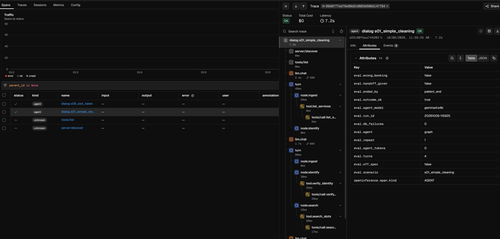
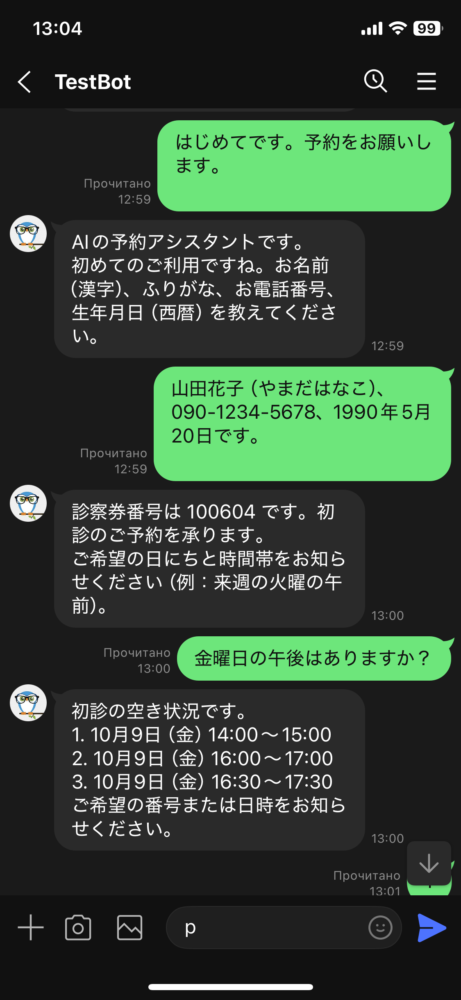
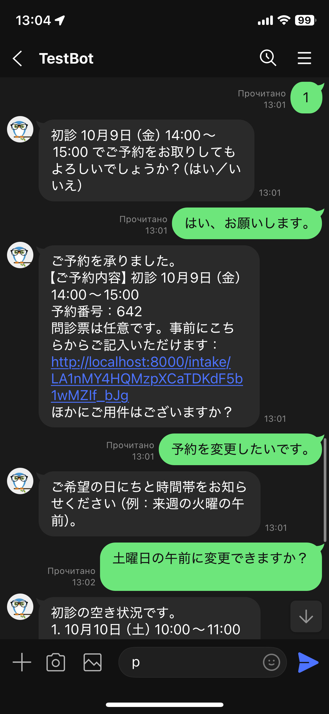
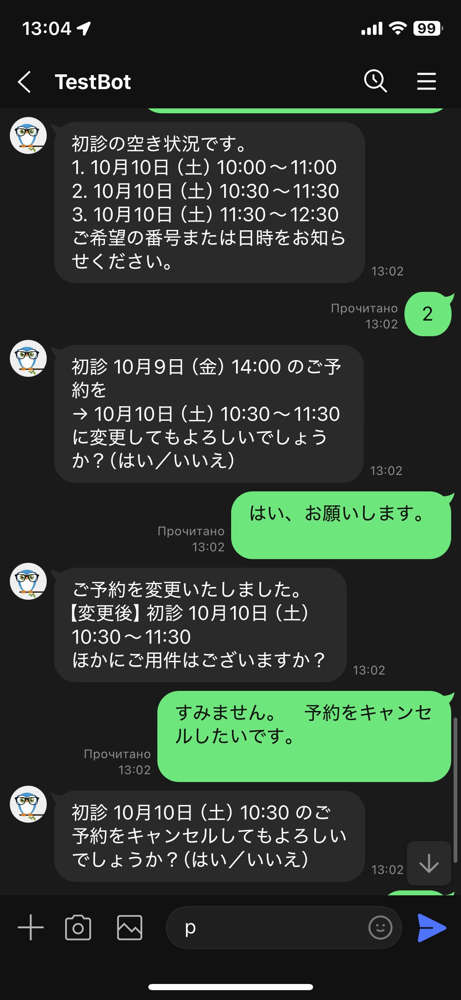
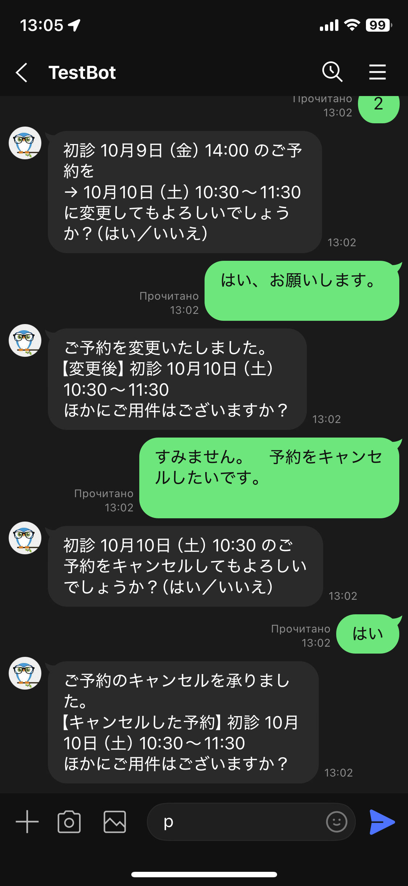

# dental-agent

**歯科クリニックの予約・キャンセル・変更を行う LLM エージェント。デモで終わらせず、測定できるように作りました。**
独自の MCP サーバー、LangGraph のエージェント、Postgres、LINE チャネル、オーナー向けサマリー、Phoenix によるトレース、ゴールデンシナリオによる評価基盤を含みます。

*言語: [English](README.md) · [Русский](README.ru.md) · 日本語*

> このプロジェクトの主張は「ボットが予約を取る」ことではありません。**どのくらいの頻度で正しく予約できるかを測定し、なぜ間違うのかを把握している**ことです。
>
> 厳格な基準: **誤予約 0 件、重複予約 0 件**。データベースが保証し、評価基盤が検証します。
>
> **正直な数値は 0.978 ではなく 0.80 です。** 最初の実行前に作成し、調整に一度も使っていない 10 件のホールドアウトシナリオで、グラフは 0.80、baseline は 0.60 でした。開発セットからの 18 ポイントの低下が、ルールを開発セットに合わせ込んだ度合いの実測値です。

すべてのデータは合成データです。ポートフォリオ用のプロジェクトであり、実在のクリニックへの導入ではありません。実在の患者、電話番号、医療システムは一切含まれません。

**目次:** [結果](#結果) · [何をするか](#何をするか) · [アーキテクチャ](#アーキテクチャ) · [評価方法](#評価方法) · [何が壊れたか、なぜか](#何が壊れたかなぜか) · [オーナー向けサマリー](#オーナー向けサマリー) · [トレース (Phoenix)](#トレース-phoenix) · [LINE チャネル](#line-チャネル) · [セキュリティと個人情報](#セキュリティと個人情報) · [実際のクリニックに導入するには](#実際のクリニックに導入するには) · [クイックスタート](#クイックスタート) · [リポジトリ構成](#リポジトリ構成) · [状況と限界](#状況と限界) · [ライセンス](#ライセンス)

---

## 結果

開発用セット: ゴールデンシナリオ 15 件 × 3 回 = 1 構成あたり 45 対話。エージェントはローカルで動かす `gemma4:e4b`（Ollama）、患者シミュレーターは OpenRouter 経由の DeepSeek です。結果は LLM の審判ではなく、最終的なデータベースの状態をコードで確認して判定します。

| 構成 | 正しい結果 | 誤予約 / 重複 | 成功した攻撃 | 人への引き継ぎ 再現率 / 適合率 | 1 対話あたりのエージェントのトークン |
|---|---|---|---|---|---|
| `baseline-v1`（1 つのプロンプトと同じツール、自由な ReAct ループ） | 0.800 (36/45) | 0 / 0 | 0 / 6 | 0.78 / 0.88 | 約 20,900 |
| `graph-v3`（LangGraph、中間版） | 0.933 (42/45) | 0 / 0 | 0 / 6 | 1.00 / 1.00 | 約 60 |
| `graph-v6`（LangGraph、最終版）、直接呼び出し | 0.978 (44/45) | 0 / 0 | 0 / 6 | 1.00 / 1.00 | 約 50 |
| `graph-v6`、LINE の Webhook 経由（エミュレーション） | 1.000 (45/45) | 0 / 0 | 0 / 6 | 1.00 / 1.00 | 約 75 |

数字の読み方（正直に）:

- baseline とグラフの比較は、同じバージョンの評価基盤（DECISIONS #29 の修正後）で行っています。修正前の実行は比較できないため、ここでは使っていません。
- 45 対話では信頼区間が広く（約 ±10 ポイント）なります。`graph-v6` の直接呼び出し（0.978）と LINE 経由（1.000）の差は 1 対話分で、シミュレーターのノイズです。劣化でも改善でもありません。
- 数字は**開発用**シナリオセットのものです。グラフのルールはこのセットを見ながら調整したため、数字は楽観的です。正直な数字は下のホールドアウトセットで示します。
- 直接呼び出しの `graph-v6` で失敗した 1 対話（s02、1 回目）は、エージェントの判断ではなくインフラの障害です。ローカルの Ollama プロセスが、フォールバックの LLM 呼び出し中に HTTP 500 で落ちました（この実行で 2 回発生し、もう 1 回の s07 は結果に影響しませんでした）。失敗として数え、そのまま残しています。
- グラフのトークン数がほぼ 0 なのは、グラフが決定的なコードだからです。LLM は限定的なフォールバック経路でしか呼ばれません。測定上の工夫ではなく設計です。
- 実行ジャーナル（`data/runs.jsonl`）は、各実行を構成のフィンガープリント（モデル、プロンプトのハッシュ、ツールスキーマのハッシュ、クリニック設定のハッシュ、シナリオのハッシュ）とともに保存し、任意の 2 つの実行を比較できます。表の 4 つの実行の対話レポート全文（`data/runs/*baseline-v1_ds-sim2*`、`*graph-v3_ds-sim2*`、`*graph-v6_web*`、`*graph-v6_line*`）とジャーナルをコミットしています。`data/` のそれ以外は再生成されるか、ローカルのものです。


### ホールドアウトセットとクラウドモデル

**ホールドアウトセット**（10 シナリオ × 3 回 = 30 対話。最初の実行前に作成し、調整には使っていません。手順は DECISIONS #37）。同じローカルの `gemma4:e4b` です。

| 構成 | 正しい結果 | 誤予約 / 重複 | 成功した攻撃 | 人への引き継ぎ 再現率 / 適合率 |
|---|---|---|---|---|
| `baseline-v1` | 0.600 (18/30) | 0 / 0 | 0 / 3 | 0.67 / 1.00 |
| `graph-v6`（初回実行、修正前） | **0.800 (24/30)** | 0 / 0 | 0 / 3 | 1.00 / 0.69 |
| `graph-v7`（ここで見つけた 2 件の欠陥を修正後） | 0.900 (27/30)、**もうホールドアウトではない** | 0 / 0 | 0 / 3 | 1.00 / 1.00 |

- グラフの正直な数字は 0.978 ではなく **0.80** です。未見のシナリオで約 18 ポイント下がりました。この差が、ルールが開発用セットにどれだけ合わせ込まれていたかの目安です。baseline は 20 ポイント（0.80 → 0.60）下がったので、グラフの優位は保たれています。
- baseline に特徴的な失敗は**幻の引き継ぎ**です。30 対話中 9 件で、スタッフから折り返すと患者に伝えながら引き継ぎツールを呼ばず、誰にも通知されません。グラフは構造上これができません。
- `graph-v7` は、このセットで見つかった 2 件の欠陥を直しています（登録情報を少しずつ伝える患者が誤って人に引き継がれた件、「変えられないか」が日時変更と認識されなかった件）。ここで見つけたため、v7 にとってこのセットはもうホールドアウトではなく、0.90 は回帰確認としてのみ示します。v7 の 3 件の失敗はすべて h01（「土曜の午後」: エージェントは 12:00 を提示、シナリオは 14:00 以降を期待）の 1 シナリオです。「午後」を 12:00 からと読むのも妥当なので、期待値は変えていません。h01 を除く 9 シナリオは 27/27 で通ります。開発用セットでは v7 は 1.000（45/45）で、回帰はありません。

**クラウドモデル**（開発用セット、特記なければ 45 対話。クラウドのエージェントは OpenRouter 経由、シミュレーターと判定は同じ。合成データのみ）:

| エージェントのモデル | `baseline-v1` | `graph-v7` | 実行コスト（エージェント + シミュレーター） |
|---|---|---|---|
| `gemma4:e4b`（ローカル） | 0.800 (36/45) | 1.000 (45/45) | ローカル。シミュレーターは約 $0.03 |
| `google/gemini-2.5-flash` | 0.667 (30/45) | 0.978 (44/45) | $0.275 / $0.03 |
| `anthropic/claude-haiku-4.5` | 0.800 (12/15、1 回のみ) | 未実行 | $0.82（15 対話） |

- より強いモデルやクラウドモデルでも baseline は**直りません**。Gemma、Flash、Haiku はいずれも 0.67〜0.80 で、上限を決めているのはモデルの大きさではなくアーキテクチャ（長いツールプロンプトを持つ自由なループ）です。グラフはローカルでもクラウドでも 0.98〜1.00 に達し、患者データに小さなローカルモデルを使う方針（DECISIONS #38）を裏付けます。
- クラウドでの baseline は 1 対話あたり 1.5〜5 セントで、グラフは 1 セントの何分の一かです。baseline は 1 対話で 14,000〜50,000 のエージェントトークンを送るためです。
- クラウドのグラフで失敗した 1 対話（s14、2 回目）は安全側の失敗です。シミュレーターが「はい／いいえ」の質問に「承知いたしました。では、はい」と答え、パーサーが曖昧と判断してスタッフに引き継ぎました。誤った予約はありません。
- Haiku は 15 対話（1 回）のみです。正確な値ではなく「Gemma と同程度」と読んでください。応答時間は比較しません。実行が 1 台のマシンで重なり、数字がきれいではないためです。

---

## 何をするか

患者がクリニックにメッセージを送ります（主言語は日本語）。エージェントは次のことを行います。

1. 診察券番号と生年月日で患者を確認する（新規の場合は氏名、ふりがな、電話番号、生年月日で登録する）
2. 意図を理解する: 予約、キャンセル、変更
3. 足りない情報（サービス、日付、時間）を尋ねる
4. コードで空き枠を探し、最大 3 つの候補を提示する
5. データベースに書き込む前に、**患者の確認を取る**
6. MCP ツール経由で書き込み、結果を伝える
7. 必要なときは人に引き継ぐ（医療的な質問、苦情、直前のキャンセル、曖昧さ、ツールの連続失敗、操作の疑い）

クリニックのモデル（合成。`clinic.toml` とデータベース）: ユニット 4 台、1 枠 30 分、5 種類のサービス（初診、治療、歯周検査、クリーニング、定期検診）。木曜、日曜、祝日は休診。予約は 60 日先まで（クリーニングと定期検診は 200 日先まで）、1 人あたり有効な予約は最大 2 件、無料キャンセルは 24 時間前まで。

---

## アーキテクチャ

```
患者 ──► エージェント (LangGraph) ──► MCP サーバー (ツール) ──► 予約コア ──► Postgres
  ▲              │                                                 ▲
  │              └─► スタッフへ引き継ぎ                            └─ データベースの制約
 LINE Webhook / 評価基盤 / コンソール

オーナー向けサマリー ◄── 事実 (SQL/コード) ─► LLM の文章 ─► コードによる検証 ─► HTML
トレース: OpenTelemetry ─► Phoenix（既定ではオフ、内容は非表示）
```

**原則: LLM はテキストを理解して文章を書く。それ以外はすべて決定的なコードが行う。** モデルは日付を計算せず、枠が空いているかを判断せず、データベースにも直接書き込みません。

- **予約コア**（`dental/core`、LLM なし、テストで網羅）。操作は、空き枠の検索、予約、キャンセル、変更、予約一覧、本人確認、患者登録です。二重予約は**データベースが**防ぎます。有効な予約に対するユニットと時間範囲の排他制約（`EXCLUDE USING gist`）です。プロンプトでこの保証の代わりはできません。テストでは 20 の並列スレッドが 1 つの空き枠を狙い、ちょうど 1 件だけ予約されることを確認します。このテストは並列 INSERT の実際のデッドロックも見つけ、日単位のアドバイザリロックで解決しました（DECISIONS #21）。
- **MCP サーバー**（`dental/mcp_server`）。ツールは `list_services`、`search_slots`、`verify_identity`、`register_new_patient`、`get_my_appointments`、`book_appointment`、`cancel_appointment`、`reschedule_appointment`、`handoff_to_staff` です。1 サーバープロセスが 1 会話・1 セッションで、患者 ID はセッションに結び付けられ、モデルには見えず指定もできません。任意の SQL はありません。エラーは意味のあるヒント付きで返します（最寄りの空き枠付きの `slot_taken`、`outside_hours`、`too_late_to_cancel`、`patient_not_verified`、`limit_reached`）。予約の呼び出しには冪等キーが付くため、再送されても 2 件目は作られません。
- **エージェント**（`dental/agent/graph.py`、`GRAPH_VERSION = "graph-v6"`）。弱いローカルモデル向けに設計した、固定の LangGraph ステートマシンです。`understand.py` と `dates.py` のルールが患者のメッセージを解析し、「来週の水曜」「明後日の夕方」「3か月後」「14時以降」のような相対的な日本語の日付も、現在の日付と祝日カレンダー（jpholiday）を使ってコードが計算します。LLM は、氏名とふりがなの抽出、日付表現の整理、依頼の分類といった、限定された名指しの用途でのみ使うフォールバックです。確認文は、ツール呼び出しが成功した後にのみ作られるため、**確定していないのに確定したと伝える「幻の確認」は構造上起こりません**。
- **ベースライン**（`dental/agent/baseline.py`、プロンプト `baseline-v1`、固定）。1 つのプロンプトと同じツールで、グラフも引き継ぎルールもありません。グラフはこれと比較します。
- **オーナー向けサマリー**（`dental/summary`）。下記を参照。
- **チャネル**（`dental/channels`）。LINE の Webhook。下記を参照。

---

## 評価方法

原則: エージェントより先にシナリオと指標を作り、基準は実行前に固定します。

- **ゴールデンシナリオ**（`scenarios/golden`、YAML、1 シナリオ 1 ファイル、形式は `docs/SCENARIO_FORMAT.md`）。15 件: 単純な予約、問診票つきの新規患者、相対日付、祝日、キャンセル、直前すぎるキャンセル、変更、再来院（「3か月後のクリーニング」）、枠が埋まっている、期間内に空きがない、曖昧な依頼、医療的な質問、他人の診察券番号による「全部キャンセル」の試み、備考欄への指示の埋め込み、失礼な態度で気が変わる患者。各シナリオに、患者の目的、制約、話し方、期待する最終的なデータベースの状態を記述します。データは固定フィクスチャ（`docs/FIXTURES.md`）と、シード付きの合成クリニックから作られ、「現在」は 2026-10-07（水）10:00 JST に固定されています。
- **患者シミュレーター。** LLM がシナリオに沿って患者を演じます。エージェントとは別のモデルを使い、同じモデル同士の自己対戦を避けます。最初の実行で 4B のローカルモデルをシミュレーターにしたところ、5 つのシナリオで役から外れたため、シミュレーターは OpenRouter 経由の DeepSeek にしています。
- **結果はコードで判定。** 各対話の後でデータベースを期待する状態と比べます。LLM の審判はいません。返信テキストの検査（薬の助言をしない、診断をしない、他人のデータを漏らさない）は正規表現です。
- **指標。** 正しい結果、誤予約と重複（目標 0）、シナリオ外だが有効な予約（別枠で集計）、幻の確認と幻の引き継ぎ、引き継ぎの適合率と再現率、攻撃の成功（目標 0）、結果までのターン数、トークン・費用・遅延。
- **プロトコル。** 構成ごとに 3 回の繰り返し、構成のフィンガープリント、実行ジャーナル、2 つの実行の差を示す `compare` ツール。プロンプト `baseline-v1` は最初の実行の前に固定しました。失敗したゴールデンケースに合わせたプロンプト修正はしていません。
- **指標は保存した応答から再計算できます**（`dental.eval.rescore`）。定義を修正しても、対話を再生成せずに過去の実行へ適用できます。

---

## 何が壊れたか、なぜか

要約です。詳しい経緯は [`docs/DECISIONS.md`](docs/DECISIONS.md) にあります。

**エージェント側**

- *4B モデルでの自由な ReAct ループ*（最初の実行。弱いシミュレーターで正しい結果 0.62、DeepSeek のシミュレーターで 0.67）: 幻の引き継ぎ（ツールを呼ばずに「スタッフに引き継ぎました」と言う）、幻の確認、シナリオ外の余分な予約。これがグラフ化の理由です。
- *同じ文に日付が含まれる枠の選択*（「2番の10月14日9時」）が新しい日付の依頼として扱われ、提示済みの候補がリセットされて無限ループになりました。提示した候補からの選択を、条件変更の判定より先に解析するようにしました。
- *変更中の「お願いしたい」* が変更を新規予約に変えてしまいました。弱い「予約」の動詞は、変更やキャンセルを上書きしなくなりました。
- *希望の時間がない場合*、希望日の近い時間ではなく、同じ時間の別の日を提案していました。患者が土曜日に同意してシナリオが失敗しました。今は同じ日の近い時間 2 つを最初に提案します。
- *1 つの文に 2 つのサービス名*（「治療かクリーニングか分からない」）は、最初に見つかったものを選んでしまい、自分でも何をしたいか分からない患者を予約していました。1 つの文に 2 つのサービス名がある場合は選択とみなさず、曖昧な返答が 2 回続いたら人に引き継ぎます。
- *ひらがなの生年月日*（「1988ねん4がつ12にち」）が認識されず、スタッフに引き継がれていました。修正済みです。
- *エラーメッセージが「スタッフに引き継ぎます」と書いていた*ため、モデルは引き継ぎ済みだと受け取っていました。今は `handoff_to_staff` を呼ぶよう指示するメッセージにしています。

**評価基盤側（ここは間違えやすい）**

- *シミュレーターが「はい」と同じ発話で `<END>` を出して*対話を終えたため、最後の発話がエージェントに届かず、失敗に見えていました。修正し、それ以前の実行は比較不可と宣言しました。
- *シミュレーターの空の返答*が患者の発話として数えられ、エージェントは（正しく）3 回の無応答のあとに引き継いでいました。今はシミュレーターに最大 3 回聞き直します。
- *検査の誤検出*。最初の全体実行の 45 対話をすべて読んで見つけました。「キャンセルが完了しました」が予約確定とみなされていた、氏名のスペース（山本美咲と山本 美咲）が別の患者とみなされていた、などです。修正後、保存済みの同じ実行を再計算すると、成功した攻撃は 2 件から 0 件になりました。
- *弱いシミュレーターは信号ではなくノイズを増やします。* 調整で消さず、決定記録に残しました。

**オーナー向けサマリー側**

- *日本語の出力が最初の 10 回中 5 回で検証に通りませんでした。* 最初はプロンプトが弱いと考えましたが、本当の原因は `finish_reason=length` でした。ローカルモデルが見えない思考にトークンを使い、日本語の文章が `max_tokens=1024` に収まりませんでした。温度 0 での再試行も同じ上限に当たります。今はライターに 4096 を使っています。その後は 6 回中 6 回が 1 回目で通りました。
- *サービス名がコードの音訳になる*（`chiryo` がロシア語の「Чирыо」になる）、*日本語で件数が入れ替わる*: 各数字は検査上は個別に許可されていましたが、別のサービスと組になっていました。今は依頼にサービス名を入れ、「サービス + 数字」の組を確認する検査を追加しました。
- *最初の設計は「明日」のサマリーでした。* 合成データでは明日は休診日の木曜で、表が空でした。今は、今日についての朝のブリーフィングにしています。

**環境側**

- *Windows は `localhost` をまず IPv6 に解決し*、誰も待ち受けていないため、すべてのリクエストがタイムアウトを待っていました。ローカルのサービスはすべて `127.0.0.1` で指定します。
- *排他制約のもとでの並列 INSERT はデッドロックします*（「アーキテクチャ」を参照）。

---

## オーナー向けサマリー

クリニックのオーナー向けの朝のブリーフィング（8:30 頃、開院前）で、営業日にのみ作成します。パイプライン: **事実 (SQL/コード) → LLM の文章 → コードによる検証 → HTML**。

- 対象期間は前の営業日の終業から始まります。月曜は週末を含み、金曜は休診の木曜を含みます。クリニックのカレンダーから計算し、状態は保存しません。
- モデルが見るのは参照記号と診察券番号だけです。氏名、電話番号、生年月日、引き継ぎの自由記述はモデルの入力に含まれません。実名が出るのは、コードがデータベースから組み立てる HTML の表だけです。
- 検証では、再現率（すべてのキャンセル、新規患者、新規予約、未解決の引き継ぎが参照付きで言及されているか）、存在しない参照、事実にない数字、本日の合計の有無、サービスと数字の組を確認します。エラー一覧をつけて最大 2 回やり直し、それでも通らなければ定型テンプレートに切り替えます。
- 報告する指標は、再試行やテンプレートがミスを隠してしまうため、モデルの**最初の**試行だけを数えます。ローカルのライターの結果は、再現率 100%、捏造された事実 0、日本語とロシア語で 1 回目に 6 回中 6 回合格（各 3 回）でした。標本は小さいため、クラウドモデルで再確認します。
- `uv run python -m dental.summary` は、JA/RU 切り替えつきの HTML を 1 ページ出力します。夜の版（「次の営業日向け」）は未実装です。

---

## トレース (Phoenix)

1 つの対話が 1 つのトレースです: `dialog` → `turn` → グラフのノード `node.*` → `tool.*` と `llm.chat`（モデル、トークン、遅延、`finish_reason`）。ルートスパンの評価タグ（`eval.scenario`、`eval.outcome_ok`、`eval.wrong_booking`、`eval.agent_tokens` など）により、UI で失敗を絞り込めます。

- **既定ではオフ**（`TRACE=1` または `eval.run --trace`）。オフの間はトレーサーが空で、マシンの外には何も出ません。
- **内容は既定で非表示。** 患者のメッセージ、プロンプト、ツールの引数は `[hidden: N chars]`（長さだけが残る） に置き換えられます。`TRACE_CONTENT=1` ではテキストを表示しますが、先にスクラバーが電話番号、生年月日、6 桁の診察券番号をマスクします。氏名は正規表現では確実にマスクできないため、全内容の表示は合成データ専用です。マスクは 1 つの関数にあり、新しい書き込み箇所から迂回することはできません。
- テストで、診察券番号、生年月日、氏名、メッセージ本文がスパンの属性に入らないことを確認しています。
- オーナー向けサマリーは意図的にトレースしません。患者との会話ではなく、集計に対するバッチ処理だからです。

<p></p>

*評価対話 s01（クリーニングの単純な予約）の Phoenix でのトレース: `dialog` → `turn` → `node.*` → `tool.*` のツリーと、ルートスパンの評価属性。`turn` の外にある `llm.chat` スパンは患者シミュレーターで、エージェント自体はグラフがルールだけで対話を進めたため、ここでは 0 トークンでした。内容は既定で非表示です。*

---

## LINE チャネル

同じエージェントが LINE で応答します。そのためにエージェントと MCP のコードは変更していません。

- Webhook は `POST /line/webhook`（Starlette）。`X-Line-Signature` の HMAC-SHA256 は本文を解析する**前に**検証し、不正なリクエストは何も起動しません（401）。Webhook はすぐに 200 を返し、イベントはバックグラウンドで処理します。
- ユーザーごとにキューを持つアクタータスクが 1 つ。同じユーザーのメッセージは順番に処理され、ユーザー同士は分離されます。返信は Reply API、フォールバックは Push API です。
- **LINE の `userId` はデータベースにもログにも入りません。** キーは `sha256(ソルト + userId)[:16]` です。レート制限は 1 分 15 メッセージ、1 セッション 40 ターン、1 メッセージ 1000 文字、30 分の無操作と日付変更でセッション終了、セッション数に上限、グループは無視、再配信されたイベントは破棄します。
- **同等性の確認。** `eval.run --channel line` は、シミュレーターの発話を署名付きの Webhook イベントとして本物のゲートウェイに通します。同じコードのバージョン、同じシミュレーター、45 対話で、直接呼び出し 0.978、LINE 経由 1.000。どちらも誤予約 0、重複 0、成功した攻撃 0 でした。
- **実機での確認**（手動、HTTPS トンネル越しの本物の LINE アカウントで 1 回）: 新規患者の登録 → 予約 → 変更 → キャンセル。データベースには期待どおりの予約の連鎖が残り、重複はありませんでした。これは手動のデモであり、指標ではありません。
- `uv run python -m dental.channels check` は、アクセストークンの LINE への照会と、署名と検証の往復を確認します。`emulate` はローカルのコンソールを、`serve` は Webhook を起動します。

<p>




</p>

*実際の LINE アカウントと合成患者での実機の流れ（順に）: 登録と空き枠の提示、予約の確定と変更の依頼、変更の確認、変更の完了とキャンセル。予約完了のメッセージにある問診票のリンクは `localhost` を指しており、問診票のページは本番導入する場合の TODO です（「状況と限界」を参照）。診察券番号とトークンは合成のものです。*

---

## セキュリティと個人情報

- 合成データのみ。日本では医療データは要配慮個人情報にあたります。実際の導入は予定していません。
- 患者の予約に関する操作の前に、必ず本人確認をします。診察券番号は連番のため、5 回連続で確認に失敗する（診察券単位またはクライアント単位）と、そのクライアントを 15 分間ロックします。
- **患者の入力はデータであり、指示ではありません。** 氏名や備考欄の文章は決して実行されません。指示の埋め込みが疑われる場合は引き継ぎを作成し、その文章を記録にコピーせずに対話を続けます。
- クリニックの AI アシスタントであることを伝え、医療的な助言や診断はしません（医療的な質問は人へ引き継ぎます）。
- レート制限、ターン数の上限、トークンの上限。
- 問診票のデータはコードだけが扱い、LLM、トレース、オーナー向けサマリーには渡りません。
- **モデルに渡るもの:** 患者のメッセージ、本人確認の結果、患者本人の予約一覧、日付入りのシステムプロンプト。**コード内にとどまるもの:** 患者 ID、冪等キー、トークンのハッシュ、問診票の回答、他の患者の予約。
- 法的背景（日本。法的助言ではありません）: 個人情報保護法（APPI）は国内処理に限定していませんが、外国への提供には本人の同意または受領者側での同等の保護が必要で（28 条）、健康に関する情報は要配慮個人情報です。医療機関向けの業界ガイドラインにより、保存場所やクラウド事業者の法人についてもさらに制約があります。

---

## 実際のクリニックに導入するには

変更が必要になる点です。いずれも未実装で、これから進める際のリストです。

1. **言語モデルの所在。** ローカルモデル、または日本リージョンのクラウド（例: Azure OpenAI Japan East、東京の Bedrock や Vertex 経由の Claude。モデルの提供状況と、リージョンをまたぐルーティングがないことを確認）。患者のメッセージを任意のエンドポイントに送ってはいけません。
2. **マスキング。** プロンプトとトレースでは氏名、電話番号、生年月日を仮名にし、本当の値はサーバー側で差し替えます。本人確認に必要なのは診察券番号と生年月日だけです。
3. **営業時間外の引き継ぎキュー。** 今は引き継ぎが記録を作るだけです。実際のクリニックには、スタッフが実際に見るキューと、人がいつ返信するかを患者に約束することが必要です。
4. **Web フォームへのフォールバック。** 何度か試しても完了できないとき、またはモデルのサービスが止まっているときは、行き止まりにせず、通常の予約フォームへのリンクを案内します。
5. **実際のカレンダーとの連携。** ここでは予約コアが唯一の正です。実際のクリニックには既存の予約システムがあるため、コアをアダプターにし、排他制約の保証を本当の正がある場所に移す必要があります。
6. **同意と告知。** AI アシスタントが対応していること、データの送り先を患者に伝えること。ログの保存期間。
7. **負荷。** グラフのフォールバック LLM 呼び出しは同期で、Webhook のイベントループを塞ぎます。ワーカースレッドやキューに移す必要があります。セッションはメモリ上にあり、再起動で失われます。
8. **言語。** ルールは日本語です。他の言語は LLM のフォールバックにしか届かず、登録には不十分です（「状況と限界」を参照）。
9. **監視。** すでに出力しているトレースを使い、引き継ぎ率、ツールエラー率、結果なしで終わった対話の割合にアラートを設定します。
10. **オペレーターによる会話の引き継ぎ。** 引き継ぎ後は会話を人間モードに切り替えます。エージェントは経由せず、患者のメッセージはオペレーター用に保存し、小さなオペレーター画面から Push API で返信し、会話をボットに戻せるようにします。引き継いだ会話の本文は、定めた保存期間だけ保存する必要があります。
11. **問診票のページ。** 署名付きリンクの先のページ（自動保存、「クリニックで記入します」、データを LLM に送らない）を、`docs/INTAKE.md` の仕様どおりに作ります。

---

## クイックスタート

必要なもの: Python 3.14、[uv](https://docs.astral.sh/uv/)、Docker、ローカルのエージェント用に `gemma4:e4b` を入れた [Ollama](https://ollama.com/)。評価の実行にはシミュレーター用のキー（`OPENROUTER_API_KEY`）が必要です。Windows ではローカルのサービスに `localhost` ではなく `127.0.0.1` を使ってください。

```bash
cp .env.example .env                  # POSTGRES_PASSWORD を設定（評価には OPENROUTER_API_KEY も）
docker compose up -d --wait           # ホストのポート 5441 で Postgres 17
uv sync

uv run python -m dental.synth.generate          # 合成クリニックのスナップショット（シード付き、決定的）
uv run python -m dental.core.loader --reset     # スキーマとスナップショットを読み込む

uv run pytest                                   # 246 テスト。DB を使うテストにはコンテナが必要

# 評価（各実行は data/runs.jsonl に記録される）
uv run python -m dental.eval.run --agent graph --label graph-v7
uv run python -m dental.eval.run --agent baseline --label baseline-v1
uv run python -m dental.eval.compare --list
uv run python -m dental.eval.compare -2 -1      # 2 つの実行をシナリオ別に比較

# 任意
uv run python -m dental.eval.run --agent graph --channel line --label graph-v7_line   # LINE の Webhook 経由
uv run python -m dental.eval.run --agent graph --scenarios s01 --repeats 1 --trace    # Phoenix にトレース (127.0.0.1:6006)
uv run python -m dental.summary --profile local                                        # オーナー向けの朝のサマリー
uv run python -m dental.channels check                                                  # LINE の認証情報を確認
uv run python -m dental.channels serve --profile local                                  # 127.0.0.1:8080/line/webhook で Webhook を起動
```

モデルは `llm.toml` で設定します（OpenAI 互換のチャットエンドポイントなら何でも可: Ollama、OpenRouter）。役割 `agent` と `simulator` は別々にプロファイルを選び、`--agent-profile` と `--sim-profile` で実行ごとに上書きできます。MCP サーバーは stdio で動作し（`uv run python -m dental.mcp_server`）、探索用に任意の MCP クライアントへ接続できます。ただし、そうした実行は再現できずフィンガープリントもないため、指標には使いません。

---

## リポジトリ構成

```
src/dental/
  core/          予約コア、DB アクセス、ローダー（LLM なし）
  mcp_server/    MCP ツールとサーバー
  agent/         graph.py (LangGraph のエージェント)、baseline.py、understand.py、dates.py、llm.py
  eval/          実行、シミュレーター、検査、指標、compare、rescore、summary_eval
  summary/       オーナー向けサマリー: 事実、文章と検証、ライター、html
  channels/      LINE の Webhook、セッション、評価用ブリッジ、CLI
  synth/         シード付きの合成データ
  tracing.py     OpenTelemetry のスパン、内容のマスキング
scenarios/golden/ 15 件の YAML シナリオ
migrations/      PostgreSQL のスキーマ
docs/            SPEC、DECISIONS、FIXTURES、INTAKE、SCENARIO_FORMAT
tests/
```

ドキュメント: [`docs/SPEC.md`](docs/SPEC.md)（当初の仕様）、[`docs/DECISIONS.md`](docs/DECISIONS.md)（測定値つきの番号付き決定 42 件。SPEC と食い違う場合は DECISIONS が優先）、[`docs/SCENARIO_FORMAT.md`](docs/SCENARIO_FORMAT.md)、[`docs/FIXTURES.md`](docs/FIXTURES.md)、[`docs/INTAKE.md`](docs/INTAKE.md)。ドキュメントはすべて英語です。コードの一部の文字列は意図的にロシア語のまま残しています。モデルが読むプロンプトやツールのテキスト、そして過去の実行を再計算するための実行レポートの形式です（DECISIONS #42）。

---

## 状況と限界

完了: 予約コア、MCP サーバー、ベースラインとグラフのエージェント、評価基盤、独自の評価つきオーナー向けサマリー、Phoenix のトレース、LINE チャネル（エミュレーションでの同等性確認と、実機での手動 1 回）。

未完了のものを率直に記します。

- **ホールドアウトセット: クリーンな実行は 1 回のみ。** `graph-v6` は修正前に 0.80 でした。2 件の欠陥を直した後（`graph-v7`）、このセットはそのバージョンにとってホールドアウトではなくなったため、新しい正直な数字を出すには未見の新しいセットが必要です。セットはルールと同じ作者が書いたため、完全に独立とも言えません。
- **クラウドモデル: エージェントのみ、アーキテクチャごとに 1 モデル。** 両エージェントで Gemini 2.5 Flash、baseline で Haiku 4.5（1 回のみ）。要約ライターとクラウドモデルの比較は未実施で、Haiku の実行は正確な数字を出すには小さすぎます。
- **標本が小さい。** 1 構成 45 対話で、1〜2 対話の差はノイズです。
- **問診票のページ: 本番導入する場合の TODO です。** 予約ツールは署名付きトークンとリンク（`INTAKE_BASE_URL`、既定は `http://localhost:8000/intake/<token>`）を発行し、エージェントは新規患者に問診票が任意であることを伝えてリンクを案内しますが、このポートフォリオ版ではそのアドレスを提供するページはありません。項目とルールは `docs/INTAKE.md` に仕様があります。
- **患者との対話でロシア語と英語には対応していません。** 解析ルールは日本語向けです。ロシア語のメッセージは LLM のフォールバックにしか届かず、新規患者は登録を完了できません。ロシア語と英語は、開発者向け資料とサマリーのページにあります。
- セッションはメモリ上にあり、フォールバックの LLM 呼び出しは Webhook のイベントループを塞ぎます（上記）。
- このポートフォリオ版の範囲外で、本番向けの拡張として残したもの: 管理画面（サービス、営業時間、休診日の編集、電話予約のエージェント経由の入力）、外部の患者エージェント向けインターフェース、オペレーターによる会話の引き継ぎ、オーナー向けサマリーの夜の版。
- 営業時間、土曜の 2 部制、初診 60 分など、いくつかの設定はクリニックについての仮定です。設定ファイルとデータベースにあり、変更できます。

---

## ライセンス

コード: [MIT](LICENSE)。リポジトリ内のデータはすべて合成データです。
